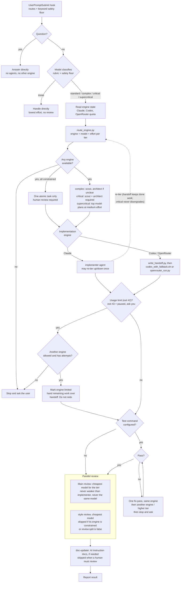

# claude-orchestrator

A Claude Code plugin (`cost-aware-orchestrator`) that makes Claude Code spend tokens
and quota deliberately:

- **Cost-aware routing**: each task is classified as trivial, standard, complex,
  critical or supercritical by the main model using conversation context and a keyword safety floor, then routed to the
  cheapest sufficient Claude model and effort.
- **Tiered subagents**: `scout` (haiku/low), `implementer` (sonnet/medium),
  `architect` (opus/high), `verifier` (sonnet/medium), `style-reviewer` (haiku/low), `doc-updater`
  (haiku/low), and `codex-reviewer`.
- **Three engines**: Claude, plus optional Codex (your local Codex CLI) and optional
  OpenRouter (pay-per-token, under a yearly allowance you choose; off by default).
- **Quota fallback**: when an engine is near or at its limit, the remaining work goes
  to another usable engine.
- **Capability-based review**: the reviewer is the cheapest model in the task's review
  row that is at least as capable as the implementer, on any engine, and never the exact
  same model. Trivial tasks get no model review; tests and lint gate them.
- **Resumable handoffs**: the replacement engine gets a handoff listing completed work
  under `## Do not redo`, never the original broad prompt.
- **Automatic activation**: on every prompt, a local hook injects a rubric, safety floor and
  per-tier routes; the main model classifies using the whole conversation. A broadly scoped skill backs it up.
  You don't need a slash command. Subagent reports are not re-classified.
  Written plans, including Superpowers plans, are routed per task during execution.

- **Usage tracking**: reads remaining Claude, Codex and OpenRouter quota from local
  files (status line input, Codex session logs, OpenRouter spend cache) and routes before an engine runs out.

No API keys, OAuth tokens or secrets are stored. Network access only happens through
your local `claude` and `codex` CLIs and, when you enable OpenRouter, the OpenRouter
runner, setup and status commands (hooks never use the network).

## How it works

On every prompt a local hook reads quota state and supplies per-tier routes and a keyword
safety floor. The model classifies using the rubric and conversation, then follows the selected route.
With OpenRouter set up, healthy and within budget, the hook instead has the model save the prompt
to a file with the Write tool and run `decide_route.py --prompt-file <file>`: one cheap OpenRouter
call (the `routing.decider` row) picks a tier, never below the keyword floor and never above
`critical` (a `supercritical` answer is only a suggestion). That tier is itself a floor: the model raises it from conversation
context, and approvals keep the approved tier. Any failure (exit 3) hands classification back
to the session model. When the decider's confidence is below `decider.min_confidence`
(default 0.9), the session asks you to choose between its tier and the alternative.



## Requirements

- Claude Code with plugin support. `/smart-task` uses the Workflow tool when your
  account has it; otherwise it runs the same steps inline with regular subagents.
- `python3` (3.11+ recommended; the scripts also run on 3.8+), `bash`, `git`
- Optional: the [Codex CLI](https://github.com/openai/codex), logged in (`codex login`)
- Optional: an [OpenRouter](https://openrouter.ai) account and API key (also needs the Codex CLI)

## Installation

```text
/plugin marketplace add StefanosFafalios/claude-orchestrator
/plugin install cost-aware-orchestrator@claude-orchestrator
```

For local development: `claude --plugin-dir /path/to/claude-orchestrator`.

## Setup

Run once per project:

```text
/cost-aware-orchestrator:setup
```

It checks Python and the Codex CLI, turns on usage tracking, creates the project config
(detecting your test, lint and typecheck commands) and offers the `.gitignore` entries.
It asks before every change.

Setup offers to move instructions into one common file and make both AGENTS.md and
CLAUDE.md point to it. The root defaults to `docs/AI_CONTEXT.md` (override with
`--common-file PATH`); nested instruction files use a local `AI_CONTEXT.md`. Setup
asks before applying changes and offers to review merged instructions for duplicates.

Setup can also show live Codex activity in the Claude Code status line, and offers
OpenRouter (see [OpenRouter](#openrouter)).

**Codex** is optional. If the `codex` CLI is installed and logged in (`codex login`), the
plugin uses it with no further configuration. Without it, set
`"engines": {"codex": false}` and everything stays on Claude.

## Usage tracking

Routing uses real quota numbers when they are available locally (no network):

| Engine | Source |
|---|---|
| OpenRouter | the spend cache written by `openrouter_budget.py` and the runner (`/api/v1/key`), paced against your caps |
| Codex | the newest session log in `~/.codex/sessions/` (`rate_limits`: 5-hour and weekly windows) |
| Claude | `~/.claude/statusline-input.json`, saved by your status line (`rate_limits.five_hour` / `seven_day`) |

The prompt hook, `route_engine.py` and `engine_state.py status` sync these on every
call. The tightest active window sets `remaining_pct`. A window past its reset time
counts as unused, so a `limited` engine recovers on its own. A newer manual
`engine_state.py set` or `mark-limit` wins over an older observation. For Claude,
`/cost-aware-orchestrator:setup` adds one save step in front of your existing status line
command. Turn syncing off with `"usage_sync": false`.

## Per-project setup

On the first nontrivial task in a project without config, Claude asks:
"Create .claude/orchestrator.config.json with default orchestration settings?" Say yes
to copy `templates/orchestrator.config.json`, then fill in your commands:

```json
{
  "commands": { "test": "pytest -q", "lint": "ruff check .", "typecheck": "mypy src" }
}
```

Project config overrides only the fields it contains. Everything else comes from the
plugin defaults. Unknown fields are ignored. Invalid JSON stops orchestration with a
clear error.

Add the runtime state to the project's `.gitignore`:

```gitignore
.claude/engine-state.json
.claude/orchestrator/
```

## Example commands

```text
/cost-aware-orchestrator:setup
/cost-aware-orchestrator:smart-task Implement retry handling for webhook failures and update tests
/cost-aware-orchestrator:engine-status
/cost-aware-orchestrator:session-usage
/cost-aware-orchestrator:reset-engine-state
```

The `request-feature` skill activates when you want orchestration behavior the plugin
lacks: it checks existing features, then files a generic issue on the plugin's
GitHub repository with `gh` (never project-specific details).

Without a command, the policy still applies:

| Prompt | Behavior |
|---|---|
| "Fix this typo" | Claude haiku/low, no fan-out |
| "Add tests for this module" | sonnet/medium with a focused implementer |
| "Debug this intermittent failure" | scout, then sonnet/high (opus/high if needed) |
| "Refactor authentication and add tests" | critical: architect plan, the critical implementation row implements, the cheapest sufficient model for the tier reviews (never weaker, never the same model) |
| "What does this function do?" | answered directly; no workflow |

## Routing policy

Routing is driven by a **capability map** (see [Capability map](#capability-map)). The
tiers and their default shape:

| Route | Examples | Implements on | Notes |
|---|---|---|---|
| trivial | typo, rename, lookup | cheapest sufficient model, low effort | inline on Claude by default |
| standard | feature, tests, docs | mid-size model, medium effort | |
| complex | debugging, multi-file | mid-size model, high effort | may escalate a tier |
| critical | production, security, migrations, auth/payment | strongest implementing model, high effort | architect plan required; only the strongest model implements: on another engine that serves it (OpenRouter) while Claude is constrained, else it stops for a human |
| supercritical | problems beyond known solutions, novel algorithms, root causes that beat a critical attempt | never (see below) | top model plans, maps tasks and reviews |

Each routing row lists models in preference order (always a list, even for one model);
each engine uses the first one it can serve (for Codex, from its local model cache; for
OpenRouter, from the cached `/models` list). A row may add `"model_effort": {"<model>": "<effort>"}`
to give a listed model its own effort instead of the row's.

**Adaptive split.** When several engines are healthy, standard and complex tasks are
shared in proportion to each engine's headroom (remaining quota above the near-limit
line). For example, Claude at 90% and Codex at 45% gives Codex about 24% of tasks. As
one engine gets closer to its limit, more work goes to the others. The choice is a
deterministic hash of the prompt and session, so the same prompt in a session routes the same way.

**Re-tiering.** The model chooses the initial route; the Haiku scout or the
implementer may correct it once per task (never below the safety floor; critical is never downgraded).

**Capability-based review.** Review rows are ordered cheapest first, and the reviewer is
the first model in the task's row that is at least as capable as the implementer, on
whichever engine can serve it. It is never the exact same model that implemented (on any
engine). Trivial tasks get no model review: the tests and lint gate them. The main review covers correctness, efficiency and security; a cheap haiku `style-reviewer`
covers standards, best practices and code/text reduction (set `review.split` to false to merge them).

**Test gate.** If the project's tests fail, the same engine gets one fix pass with only
the failing output. If they still fail, another engine at the same tier (or the
architecture model) gets one try, then it stops and asks you. The review then uses a model
that wrote none of the code.

**Doc updates.** Once a nontrivial task passes its tests and review, a cheap `doc-updater`
pass checks whether the AI instruction docs (`AI_CONTEXT.md`, `CLAUDE.md`, `AGENTS.md`,
project skills and agents) still describe the code, and makes the smallest fix if not. It
never touches the README, other docs, code or config, and never commits.

When an engine is constrained (near limit or limited), its work goes to another usable
engine at the equivalent tier. Critical implementation lists only the strongest
implementing model, so it moves only to an engine that serves that same model (OpenRouter
serves Opus); without one it stops for a human. When all are constrained, the engine with the most remaining quota does one atomic task and a human
reviews. Full table:
[`skills/cost-aware-orchestration/references/routing-policy.md`](skills/cost-aware-orchestration/references/routing-policy.md).

Tune it per project:

```json
{
  "routing": { "implementation": { "standard": { "models": ["sonnet"], "effort": "medium" } } },
  "balance": { "mode": "adaptive", "routes": ["standard", "complex"] }
}
```

Legacy `defaults`, `codex.tiers` and `codex.default_model` keys are ignored (the hook
names any it finds); put those choices in `routing` rows instead. Set
`"balance": {"mode": "off"}` to send each route to the engine of its first-listed
model, so the others work only as fallbacks and reviewers.

## Supercritical tier

For work that needs the best available reasoning rather than more size: problems beyond
current state of the art, novel algorithms or proofs, root causes that defeated a critical
attempt. It is chosen by the model's classification, your explicit request, or a re-tier
after a failed critical attempt (there is no keyword floor).

- The top model **reasons, maps the work into tasks and reviews. It never implements**:
  each planned task is implemented on its own tier, at most `critical`.
- **Its effort is `medium` by default.** An effort explicitly named by you is recorded with
  `engine_state.py set-effort --task-id <id> --effort <e>` and also applies to child tasks.
  Configurations that opt into an `ask` row retain the former ask flow.
- It keeps critical's safeguards: architect required, never downgraded, human review when
  engines are constrained.

## Capability map

The default `models` catalog lists each canonical model once, with its name per engine
(for example the Claude alias and the OpenRouter slug for the same model) and one
composite capability `score`; the benchmark evidence, sources, dates and prices behind each
score live in the maintainers' decision log (`map_meta.log`). The `routing` section ranks
models per role (implementation, review, scout, style review, architecture, docs, decider)
and tier, with an effort. Every listed model clears that tier's bar, so work is split by
headroom across the engines that can serve one. Because identity is per model, not per
engine, "same model" and "at least as capable" are decided correctly across engines.
Override any row in your project config. The shipped defaults are a starting point, not a
requirement. Maintainers refresh them with the repo-only `review-models` skill
(`.claude/skills/review-models/`), which is not shipped with the plugin.

## OpenRouter

OpenRouter is an optional pay-per-token engine, **off by default**. Without it, behavior
is the same as before. It is enabled when `engines.openrouter` is `true` and the key
environment variable (default `OPENROUTER_API_KEY`, configurable as `openrouter.key_env`)
is non-empty. When enabled it takes a share of work like any healthy engine.

**Setup.** Run `/cost-aware-orchestrator:setup` and accept the OpenRouter step. It walks
you through creating a key on the OpenRouter site, setting the key's credit limit, and
verifying it. Store the key in your shell profile (`export OPENROUTER_API_KEY=...`),
**never in the project, config, state or chat**.

**Yearly allowance to caps.** You give a yearly USD allowance; setup derives the monthly
cap (yearly / 12, the hard limit on the key), a weekly cap (2x the average week) and a
daily cap (3x the average day) and writes them to the project config. They allow bursts
while the monthly cap keeps the year within budget. The router also paces spend against
the month so the allowance is spread out: ahead of pace makes OpenRouter `near_limit`
(deprioritized), and only a spent cap makes it `limited`. Inspect or refresh with
`python3 scripts/openrouter_budget.py caps|verify|refresh`.

**Pause, resume, stop.** `scripts/openrouter_run.py` runs OpenRouter models through the
Codex CLI (your own Codex config is untouched) and polls spend while a run is active. A
spent budget exits **42** (limit, normal fallback). If the daily or weekly cap is exceeded
mid-run, the run is suspended, not killed, and exits **43** ("paused, awaiting your
decision"); you are asked to continue or stop. `openrouter_run.py --resume RUN_ID`
continues it, `--stop RUN_ID` ends it and the remaining work goes through the normal
handoff. A request already in flight when the pause happens still completes and bills.

## Fallback behavior

1. `scripts/claude_with_fallback.sh`, `scripts/codex_with_fallback.sh` and
   `scripts/openrouter_run.py` exit **42** only on usage-limit messages (`usage limit`, `hit your session/weekly limit`,
   `limit reached`, and `resets`/`upgrade` when no auth or network error is present).
   Authentication, permission, network and ordinary errors exit 1 and are never handed off.
   Exit **43** (OpenRouter only) means paused awaiting your decision, never a fallback.
2. On 42, the engine is marked `limited` in `.claude/engine-state.json`. A handoff is
   written to `.claude/orchestrator/handoffs/<task-id>.md` (objective, completed and
   remaining work, diff, failing tests, project commands, constraints, output contract).
   Only the remaining work goes to another usable engine.
   `claude_with_fallback.sh` runs Claude with `--permission-mode acceptEdits` by default
   (edits allowed, shell commands such as tests need approval). Set
   `CLAUDE_PERMISSION_MODE` to change it.
3. Each engine is tried at most once per task. If all hit limits, orchestration stops
   and asks you.
4. To resume an interrupted run, relaunch the workflow with `resumeFromRunId`, or pass
   the saved handoff (`handoff: ".claude/orchestrator/handoffs/<id>.md"`).

Usage tracking (above) switches engines before quota runs out. Without it, record what
`/usage` shows yourself:

```bash
python3 "$PLUGIN/scripts/engine_state.py" set --engine claude --remaining-pct 20   # → near_limit
```

**Codex → Claude**: to let a Codex session hand off to Claude, add this to the project's
`AGENTS.md`:

```markdown
If Codex reports a usage limit mid-task, write a handoff with
`python3 <plugin>/scripts/write_handoff.py --target-engine claude ...` and run
`bash <plugin>/scripts/claude_with_fallback.sh <handoff>`. Exit 42 means Claude is limited too: stop.
```

## Security rules

- No credentials, tokens or user-specific config in the repository or in state. The
  OpenRouter key lives only in your shell environment and is never put on a command line.
- Error messages, diffs and test output are scrubbed of credential-shaped strings
  before they are persisted or handed off.
- Delegated Codex runs default to `--sandbox read-only`. Only implementation uses
  `workspace-write`.
- Hooks read local files only and never call `claude`, `codex`, OpenRouter or the network.
- The dispatch guard only *denies*. It never auto-approves, so your permission rules
  still apply.
- All engines follow
  [`references/coding-standards.md`](skills/cost-aware-orchestration/references/coding-standards.md):
  smallest diff, no commits unless asked, and no agent attribution
  (`Co-Authored-By`, "Generated with") in commits or PRs.

## Updating thresholds

```json
{ "thresholds": { "near_limit_pct": 30 } }
```

An engine whose `remaining_pct` is below `near_limit_pct` is treated as `near_limit`.
Models and efforts are overridden per row under `routing`, e.g.
`{"routing": {"implementation": {"standard": {"models": ["opus"], "effort": "medium"}}}}`.

## Disabling Codex

```json
{ "engines": { "codex": false } }
```

All routing then stays on Claude (and OpenRouter, if enabled). To keep Codex for review
only, override the `routing.implementation` rows without Codex models (`gpt-…`): standard
work lists a Codex model first, so `fallback.claude_to_codex: false` alone does not stop
Codex implementing. OpenRouter is disabled the same way (`"engines": {"openrouter": false}`, the default).
To turn off automatic orchestration (the hook
then injects `ORCHESTRATION POLICY DISABLED`, and `/smart-task` still works):

```json
{ "engines": { "claude": false, "codex": false, "openrouter": false }, "automatic": false }
```

## Troubleshooting

| Symptom | Fix |
|---|---|
| `error: invalid JSON in .../orchestrator.config.json` | Fix the reported line and column. Orchestration stays stopped until the file parses |
| Stuck on Codex after the Claude quota reset | `/cost-aware-orchestrator:reset-engine-state`, or `engine_state.py set --engine claude --remaining-pct 100` |
| Dispatch denied by `[cost-aware-orchestrator]` | Follow the reason, or add a `Justification:` line for a standard task that needs the architect |
| Codex wrapper exits 1 with "not logged in" | Run `codex login`. This is not a quota failure, so there is no fallback |
| OpenRouter never used | Needs `engines.openrouter: true` and a non-empty key variable in the shell that launched Claude Code (restart it after editing your profile) |
| Run exits 43 | Over a daily/weekly cap mid-run: `openrouter_run.py --resume RUN_ID` or `--stop RUN_ID` |
| Hook seems silent | Check `claude --debug`. The hook prints JSON with `hookSpecificOutput.additionalContext` |

## Running tests

```bash
python3 -m pytest -q        # offline; workflow scenarios need node
ruff check .
shellcheck scripts/*.sh     # if installed
```

The tests never invoke the real `claude`, `codex` or OpenRouter (the OpenRouter caches are
isolated by env vars and nothing touches the network). The wrappers are exercised with
fake CLIs, and `workflows/smart-task.js` runs under `tests/workflow_harness.mjs` with
mocked agents.

## License

MIT
